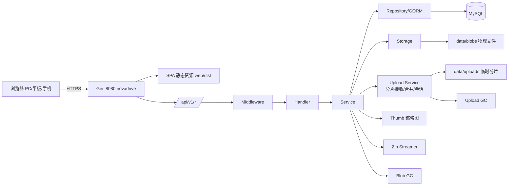

# NovaDrive（星云盘）最终设计文档 v2.1 FINAL

> **产品名称：NovaDrive / 星云盘**
> **后端服务名：`novadrive`**（Go module `github.com/iokr/novadrive`，二进制 `novadrive`）
> **代码仓库：`github.com/iokr/novadrive`**
> **文档状态：定稿（Final）**，v2.1 在 v2.0 基础上将原 `backend/` 目录内容提升到仓库根目录，项目结构更扁平。

---

## 目录

1. 产品概述
2. 功能需求
3. 非功能需求
4. 技术架构
5. 项目目录结构
6. 数据库设计
7. API 设计
8. 后端设计要点
9. 前端设计
10. 构建与部署
11. 安全性设计
12. 里程碑与验收
13. 交付物清单

---

## 一、产品概述

### 1.1 产品定位
NovaDrive（星云盘）是一套开箱即用的私有云盘系统，单二进制部署。支持多用户注册、文件与目录管理、**大文件分片断点续传**、PDF/图片/视频/音频/文本在线预览、文件夹批量上传、单文件与目录 zip 下载、秒传去重、收藏、最近访问、复制、缩略图、分享（含二维码）、空间分析与管理员后台。

### 1.2 目标用户
- **个人用户**：上传大文件（高清视频、镜像、备份）、远程访问
- **小团队**：目录分享、收藏整理、按需检索
- **运维 / 开发者**：单机私有化部署，二进制即服务

### 1.3 核心价值
| 价值点 | 说明 |
|---|---|
| 极简部署 | 前后端一体，`./novadrive` 一条命令启动 |
| 大文件友好 | 分片并发上传 + 断点续传，弱网/大文件场景稳定可靠 |
| 全类型预览 | PDF、图片（含缩略图）、视频、音频、文本在线查看 |
| 整目录搬运 | 文件夹上传保留结构；目录 / 批量 zip 流式下载 |
| 秒传去重 | 基于 MD5 的全局物理去重，重复文件秒级完成 |
| 组织与发现 | 收藏、最近访问、全局搜索（Ctrl+K）、拖拽移动 |
| 目录分享 | 分享链接 + 提取码 + 二维码 |
| 可管理 | 管理员后台：用户、配额、系统统计 |
| 多端适配 | PC / 平板 / 手机自适应 |
| 科技感 UI | 深色渐变 + 玻璃拟态，简洁美观 |

### 1.4 品牌规范
| 项 | 值 |
|---|---|
| 英文名 | NovaDrive |
| 中文名 | 星云盘 |
| 仓库 | `github.com/iokr/novadrive` |
| 服务名 / 二进制 | `novadrive` |
| Logo 概念 | 靛蓝到青色的旋涡星云，中心一个发光的"文件"符号 |
| Slogan | "你的私人星云，数据随取随用" |
| UI 前缀文案 | NovaDrive · 星云盘 |

### 1.5 术语
| 术语 | 说明 |
|---|---|
| 文件 / 目录 | 用户可见的逻辑条目（`files` 表） |
| 物理文件（Blob） | 磁盘上的实体文件，按 MD5 全局唯一（`blobs` 表） |
| 分片上传 | 将大文件切分为固定大小的分片，逐片上传至服务端后合并 |
| 上传会话 | 一次分片上传的上下文（`upload_sessions` 表） |
| 秒传 | 上传前或上传中检测到相同 MD5，跳过物理传输或落盘 |
| 断点续传 | 会话存续期内，客户端可重新获取已上传分片并继续剩余分片 |
| 引用计数 | Blob 被逻辑文件引用的次数，为 0 时物理文件可被 GC 清理 |
| 分享 | 通过 token 链接对外开放文件或目录 |

---

## 二、功能需求

### 2.1 用户模块
| 编号 | 功能 | 描述 |
|---|---|---|
| U-01 | 注册 | 用户名 + 邮箱 + 密码，开放注册 |
| U-02 | 登录 | 用户名或邮箱 + 密码，签发 JWT |
| U-03 | 登出 | 前端清除 token |
| U-04 | 个人中心 | 修改昵称、头像、密码 |
| U-05 | 空间统计 | 已用 / 总配额、文件数、按类型分布 |

### 2.2 文件管理模块
| 编号 | 功能 | 描述 |
|---|---|---|
| F-01 | 上传文件（小文件） | 单文件直接 multipart 上传，适用于 ≤ 阈值（默认 10MB） |
| F-02 | 上传文件（分片） | 大文件自动走分片流程：init → 分片并发上传 → complete；支持断点续传 |
| F-03 | 上传文件夹 | 保留目录结构；每个文件按大小自动选择普通或分片上传 |
| F-04 | 秒传 | 同 MD5 已存在则跳过物理传输（含分片 init 阶段的秒传检测） |
| F-05 | 新建目录 | 目录名同父下唯一 |
| F-06 | 目录浏览 | 面包屑、下钻、返回 |
| F-07 | 列表 / 网格视图 | 两种视图切换，排序 |
| F-08 | 重命名 | 文件与目录 |
| F-09 | 移动 | 目录树选择或拖拽移动 |
| F-10 | 复制 | 复制文件或目录（目录递归） |
| F-11 | 删除 | 软删除进回收站 |
| F-12 | 回收站 | 查看、还原、彻底删除、清空 |
| F-13 | 收藏 / 星标 | 标记常用文件 |
| F-14 | 最近访问 | 记录最近打开的文件 |
| F-15 | 单文件下载 | `attachment`，中文文件名，支持 Range |
| F-16 | 目录下载 | zip 流式下载，保留层级 |
| F-17 | 批量下载 | 勾选多项打包 zip |
| F-18 | 搜索 | 文件名关键字搜索（顶栏 + 全局面板 Ctrl+K） |
| F-19 | 存储配额 | 超出拒绝上传（分片上传按会话级累计校验） |

### 2.3 上传会话管理
| 编号 | 功能 | 描述 |
|---|---|---|
| T-01 | 初始化会话 | 客户端提交文件名、大小、MD5、分片大小、总片数；服务端做秒传检测、配额校验、会话创建或复用 |
| T-02 | 分片上传 | 每个分片独立 HTTP 请求，服务端幂等接收 |
| T-03 | 合并 | 校验分片完整性与 MD5 → 按序合并 → 入库 |
| T-04 | 进度查询 | 返回已上传分片索引列表与状态 |
| T-05 | 断点续传 | 刷新页面/断网恢复后，通过 init 或 status 取回已上传分片列表，仅补传缺失分片 |
| T-06 | 取消会话 | 客户端主动取消，服务端清理分片目录并标记会话状态 |
| T-07 | 会话过期 GC | 定时任务清理超时未完成会话 |
| T-08 | 分片幂等 | 同一 index 重复上传时覆盖写入，不产生副作用 |

### 2.4 在线预览模块
| 编号 | 功能 | 描述 |
|---|---|---|
| P-01 | PDF 预览 | pdf.js 渲染，翻页 / 缩放 / 跳页 |
| P-02 | 视频播放 | HTML5 `<video>`，Range 支持拖动 |
| P-03 | 图片预览 | 缩放、旋转、切换、原图；列表页用缩略图 |
| P-04 | 音频播放 | mp3 / wav / flac / ogg |
| P-05 | 文本预览 | txt / md / json / log，前 1MB |
| P-06 | 不支持类型 | 提示下载 |

### 2.5 分享模块
| 编号 | 功能 | 描述 |
|---|---|---|
| S-01 | 创建分享 | 文件或目录，可选提取码、有效期、下载次数上限 |
| S-02 | 二维码 | 分享弹窗内生成二维码，可复制链接或下载图片 |
| S-03 | 我的分享 | 列表、复制、取消、查看统计 |
| S-04 | 公开访问 | 逐层浏览、预览、单文件下载、整目录 zip |
| S-05 | 访问统计 | 访问次数、下载次数 |
| S-06 | 失效控制 | 过期 / 取消 / 超下载次数 |

### 2.6 管理员模块
| 编号 | 功能 | 描述 |
|---|---|---|
| A-01 | 用户列表 | 分页、按用户名/邮箱搜索 |
| A-02 | 禁用 / 启用 | 修改 `status` |
| A-03 | 配额调整 | 修改 `storage_quota` |
| A-04 | 系统统计 | 用户数、文件数、物理存储、逻辑占用 |
| A-05 | 上传会话监控 | 查看活跃分片会话（可选，用于排查） |

### 2.7 系统模块
| 编号 | 功能 | 描述 |
|---|---|---|
| SYS-01 | YAML 配置 | 唯一配置来源，不使用环境变量 |
| SYS-02 | 本地存储 | Blob 按哈希分片；分片临时目录按会话隔离 |
| SYS-03 | 静态托管 | 前端 embed，SPA fallback |
| SYS-04 | 统一响应 | `{code, message, data}` |
| SYS-05 | 日志 | 请求日志 + 错误日志落文件 |
| SYS-06 | Blob GC | 定时清理 `ref_count = 0` 的物理文件 |
| SYS-07 | 上传会话 GC | 定时清理过期未完成会话 |

---

## 三、非功能需求

| 类别 | 要求 |
|---|---|
| 性能 | 列表 P95 < 200ms；缩略图 P95 < 100ms；zip 流式；分片合并按 4–16MB 缓冲区流式拼接 |
| 大文件 | 单文件上限 2GB（可配）；分片合并内存占用与文件大小无关 |
| 弱网 | 分片粒度重试；断点续传；客户端并发可配 |
| 兼容性 | 主流浏览器最近两个大版本；文件夹上传依赖 `webkitdirectory` / `webkitGetAsEntry` |
| 响应式 | 手机 < 768px，平板 768–1199px，桌面 ≥ 1200px |
| 安全 | bcrypt；JWT；目录穿越防护；上传白名单；zip 内路径安全；分片会话仅本人可操作 |
| 可靠性 | 事务保证 Blob 引用计数；会话 GC 兜底；失败分片可重试 |
| 可维护性 | 严格分层；配置驱动；无硬编码 |
| 数据一致性 | 合并后的物理文件与 files/blobs 在同事务中写入；分片目录在合并成功后清理 |

---

## 四、技术架构

### 4.1 技术栈
| 层 | 技术 |
|---|---|
| 后端 | Go 1.22+ / Gin / GORM v2 |
| 数据库 | MySQL 8.0 |
| 认证 | golang-jwt/jwt/v5 + bcrypt |
| 配置 | viper + YAML |
| 日志 | zap |
| 压缩 | archive/zip |
| 图片 | 标准库 image + golang.org/x/image（webp） |
| 分片上传 | 标准库 `os` + `io` 流式拼接；`crypto/md5` 校验 |
| 前端 | Vue 3.4 / Vite 5 / Pinia / Vue Router 4 / Element Plus |
| 预览 | pdfjs-dist；原生 `<video>`、`` |
| 前端上传 | `spark-md5`（分片 MD5 / 全文件 MD5）、`p-limit`（并发控制） |
| 其他 | axios、qrcode.vue |

### 4.2 架构图


### 4.3 关键设计决策
1. **前后端同仓 + 前端 embed**：`vite build` → `web/dist`，Go 用 `//go:embed all:dist` 打包进二进制（embed 指令与 `dist` 同处 `web/` 包内，满足 Go embed 不允许 `..` 的约束）。
2. **逻辑文件与物理文件分离**：`files` 引用 `blobs`（MD5 唯一）；分片合并完成后走统一 blob 流程，秒传与去重天然打通。
3. **分片存文件系统，会话存 DB**：分片以 `data/uploads/{upload_id}/{index}.part` 落盘，不需要在 DB 中记录每个分片（避免千万级行）；已上传分片通过扫描目录得出，天然幂等。
4. **会话幂等**：同一 `upload_id` + `index` 重复上传覆盖写；`complete` 重复调用时若会话已合并，返回已入库的文件信息。
5. **合并后统一入口**：合并产物仍按"先算 MD5 → 查 blobs → 命中引用 +1 / 未命中移动落库"逻辑入库，与普通上传共用同一段代码。
6. **阈值分流**：前端根据 `file.size > threshold`（默认 10MB）决定走普通上传还是分片上传；服务端两个入口独立可用。
7. **配额在 init 阶段预占**：init 时校验 `storage_used + size <= quota`，合并成功后才实际 `+= size`。
8. **权限分级**：`users.role`（0 普通 / 1 管理员），管理员路由单独中间件。
9. **zip 流式**：`io.Pipe` + `archive/zip` 直写 `ResponseWriter`，不落临时文件。
10. **缩略图异步**：上传/合并后 goroutine 生成，失败不影响主流程；请求缺失时回落原图。

---

## 五、项目目录结构

> v2.1 变更：去掉 `backend/` 层级，后端代码直接位于仓库根目录；`web/` 同时承载前端产物与 embed 包。

```text
novadrive/                             # github.com/iokr/novadrive
├── Makefile
├── README.md
├── LICENSE
├── go.mod                             # module github.com/iokr/novadrive
├── go.sum
├── scripts/
│   ├── build.sh
│   └── init.sql
│
├── cmd/
│   └── novadrive/
│       └── main.go                    # 二进制入口 novadrive
├── config/
│   └── config.yaml                    # 唯一配置文件
├── data/                              # 运行时数据（可配置到别处）
│   ├── blobs/                         # 物理文件（按 hash 分片）
│   ├── thumbs/                        # 缩略图
│   └── uploads/                       # 分片临时目录 {upload_id}/{index}.part
├── logs/                              # 日志目录
│
├── web/
│   ├── embed.go                       # //go:embed all:dist
│   └── dist/                          # 前端构建产物（vite outDir 目标）
│       └── .gitkeep
│
├── internal/
│   ├── config/
│   │   └── config.go                  # YAML 结构体与加载
│   ├── router/
│   │   ├── router.go                  # 路由注册 + SPA 静态托管
│   │   └── spa.go                     # NoRoute 处理（引用 web 包）
│   ├── middleware/
│   │   ├── auth.go
│   │   ├── admin.go
│   │   ├── cors.go
│   │   ├── logger.go
│   │   └── recover.go
│   ├── handler/
│   │   ├── auth_handler.go
│   │   ├── user_handler.go
│   │   ├── file_handler.go
│   │   ├── upload_handler.go          # init/chunk/status/complete/cancel
│   │   ├── share_handler.go
│   │   └── admin_handler.go
│   ├── service/
│   │   ├── auth_service.go
│   │   ├── user_service.go
│   │   ├── file_service.go
│   │   ├── upload_service.go          # 会话创建/分片接收/合并/断点续传
│   │   ├── blob_service.go
│   │   ├── share_service.go
│   │   ├── thumb_service.go
│   │   └── admin_service.go
│   ├── repository/
│   │   ├── db.go
│   │   ├── user_repo.go
│   │   ├── file_repo.go
│   │   ├── blob_repo.go
│   │   ├── upload_repo.go
│   │   └── share_repo.go
│   ├── model/
│   │   ├── user.go
│   │   ├── file.go
│   │   ├── blob.go
│   │   ├── upload_session.go
│   │   └── share.go
│   ├── dto/
│   │   ├── auth_dto.go
│   │   ├── user_dto.go
│   │   ├── file_dto.go
│   │   ├── upload_dto.go
│   │   ├── share_dto.go
│   │   └── admin_dto.go
│   ├── storage/
│   │   ├── storage.go                 # 存储接口
│   │   └── local.go                   # 本地实现
│   ├── jobs/
│   │   ├── blob_gc.go
│   │   └── upload_gc.go
│   └── constants/
│       └── constants.go
│
├── pkg/
│   ├── jwt/jwt.go
│   ├── resp/resp.go
│   ├── hash/hash.go
│   ├── random/random.go
│   ├── fileutil/fileutil.go
│   ├── ziputil/ziputil.go
│   └── logger/logger.go
│
└── frontend/
    ├── index.html
    ├── package.json
    ├── vite.config.js                 # outDir: '../web/dist'
    └── src/
        ├── main.js
        ├── App.vue
        ├── api/
        │   ├── request.js
        │   ├── auth.js
        │   ├── file.js
        │   ├── upload.js              # init/chunk/status/complete/cancel
        │   ├── share.js
        │   └── admin.js
        ├── assets/
        ├── components/
        │   ├── FileGrid.vue
        │   ├── FileTable.vue
        │   ├── Breadcrumb.vue
        │   ├── UploadPanel.vue
        │   ├── PreviewModal.vue
        │   ├── PdfViewer.vue
        │   ├── VideoPlayer.vue
        │   ├── ImageViewer.vue
        │   ├── AudioPlayer.vue
        │   ├── TextViewer.vue
        │   ├── ShareDialog.vue
        │   ├── GlobalSearch.vue
        │   ├── StorageChart.vue
        │   ├── MoveDialog.vue
        │   └── EmptyState.vue
        ├── layouts/
        │   ├── MainLayout.vue
        │   └── AdminLayout.vue
        ├── router/index.js
        ├── stores/
        │   ├── user.js
        │   ├── file.js
        │   └── upload.js
        ├── styles/
        │   ├── index.scss
        │   └── theme.scss
        ├── utils/
        │   ├── format.js
        │   ├── fileType.js
        │   ├── folderReader.js
        │   └── md5.js
        └── views/
            ├── Login.vue
            ├── Register.vue
            ├── Home.vue
            ├── Recycle.vue
            ├── Favorites.vue
            ├── Recent.vue
            ├── Shares.vue
            ├── Profile.vue
            ├── ShareAccess.vue
            └── admin/
                ├── Users.vue
                └── Dashboard.vue
```

### 5.1 embed 包约定（`web/embed.go`）
```go
package web

import "embed"

// Dist 嵌入前端构建产物，供 router 提供 SPA 静态资源。
// 注意：dist 必须与本文件同目录（Go embed 不允许 .. 向上引用）。
//
//go:embed all:dist
var Dist embed.FS
```

### 5.2 SPA 路由引用
```go
// internal/router/spa.go
import (
    "io/fs"
    "net/http"
    "strings"

    "github.com/gin-gonic/gin"
    "github.com/iokr/novadrive/pkg/resp"
    "github.com/iokr/novadrive/web"
)

func registerSPA(r *gin.Engine) {
    dist, _ := fs.Sub(web.Dist, "dist")
    r.NoRoute(func(c *gin.Context) {
        p := c.Request.URL.Path
        if strings.HasPrefix(p, "/api/") {
            resp.Fail(c, 404, "not found")
            return
        }
        if f, err := dist.Open(strings.TrimPrefix(p, "/")); err == nil {
            f.Close()
            c.FileFromFS(p, http.FS(dist))
            return
        }
        c.FileFromFS("/", http.FS(dist)) // SPA fallback
    })
}
```

---

## 六、数据库设计

> 字符集 `utf8mb4` / 排序 `utf8mb4_unicode_ci` / 引擎 `InnoDB`，**所有字段均带注释**。

### 6.1 users（用户表）
```sql
CREATE TABLE `users` (
  `id`             BIGINT UNSIGNED NOT NULL AUTO_INCREMENT       COMMENT '用户主键ID',
  `username`       VARCHAR(32)     NOT NULL                      COMMENT '用户名，登录账号，全局唯一',
  `email`          VARCHAR(128)    NOT NULL                      COMMENT '邮箱，全局唯一，可用于登录',
  `password_hash`  VARCHAR(255)    NOT NULL                      COMMENT '密码哈希（bcrypt）',
  `nickname`       VARCHAR(64)     NOT NULL DEFAULT ''           COMMENT '昵称，展示名称',
  `avatar`         VARCHAR(255)    NOT NULL DEFAULT ''           COMMENT '头像访问路径，空表示默认头像',
  `role`           TINYINT         NOT NULL DEFAULT 0            COMMENT '角色：0-普通用户，1-管理员',
  `status`         TINYINT         NOT NULL DEFAULT 1            COMMENT '账号状态：0-禁用，1-正常',
  `storage_used`   BIGINT UNSIGNED NOT NULL DEFAULT 0            COMMENT '已用逻辑存储（字节），按 files.size 累加',
  `storage_quota`  BIGINT UNSIGNED NOT NULL DEFAULT 10737418240  COMMENT '存储配额上限（字节），默认10GB',
  `last_login_at`  DATETIME        DEFAULT NULL                  COMMENT '最后登录时间',
  `created_at`     DATETIME        NOT NULL DEFAULT CURRENT_TIMESTAMP COMMENT '创建时间',
  `updated_at`     DATETIME        NOT NULL DEFAULT CURRENT_TIMESTAMP ON UPDATE CURRENT_TIMESTAMP COMMENT '更新时间',
  PRIMARY KEY (`id`),
  UNIQUE KEY `uk_username` (`username`),
  UNIQUE KEY `uk_email` (`email`)
) ENGINE=InnoDB DEFAULT CHARSET=utf8mb4 COLLATE=utf8mb4_unicode_ci COMMENT='用户表';
```

### 6.2 blobs（物理文件表）
```sql
CREATE TABLE `blobs` (
  `id`            BIGINT UNSIGNED NOT NULL AUTO_INCREMENT        COMMENT '物理文件主键ID',
  `hash_md5`      CHAR(32)        NOT NULL                       COMMENT '文件MD5哈希，全局唯一，用于秒传与去重',
  `size`          BIGINT UNSIGNED NOT NULL                       COMMENT '物理文件大小（字节）',
  `ext`           VARCHAR(32)     NOT NULL DEFAULT ''            COMMENT '主扩展名（小写，不含点）',
  `mime_type`     VARCHAR(128)    NOT NULL DEFAULT ''            COMMENT 'MIME类型',
  `storage_path`  VARCHAR(512)    NOT NULL                       COMMENT '物理存储相对路径，按 hash 前两位分片',
  `thumb_path`    VARCHAR(512)    NOT NULL DEFAULT ''            COMMENT '缩略图相对路径，空表示无缩略图',
  `ref_count`     INT UNSIGNED    NOT NULL DEFAULT 1             COMMENT '引用计数，为0时物理文件可被GC清理',
  `created_at`    DATETIME        NOT NULL DEFAULT CURRENT_TIMESTAMP COMMENT '创建时间',
  `updated_at`    DATETIME        NOT NULL DEFAULT CURRENT_TIMESTAMP ON UPDATE CURRENT_TIMESTAMP COMMENT '更新时间',
  PRIMARY KEY (`id`),
  UNIQUE KEY `uk_hash_md5` (`hash_md5`),
  KEY `idx_ref_count` (`ref_count`)
) ENGINE=InnoDB DEFAULT CHARSET=utf8mb4 COLLATE=utf8mb4_unicode_ci COMMENT='物理文件表（秒传与去重）';
```

### 6.3 files（文件与目录表）
```sql
CREATE TABLE `files` (
  `id`              BIGINT UNSIGNED NOT NULL AUTO_INCREMENT      COMMENT '文件/目录主键ID',
  `user_id`         BIGINT UNSIGNED NOT NULL                     COMMENT '所属用户ID，关联 users.id',
  `parent_id`       BIGINT UNSIGNED NOT NULL DEFAULT 0           COMMENT '父目录ID，0表示根目录',
  `name`            VARCHAR(255)    NOT NULL                     COMMENT '文件或目录名称（含扩展名）',
  `is_dir`          TINYINT         NOT NULL DEFAULT 0           COMMENT '类型：0-文件，1-目录',
  `ext`             VARCHAR(32)     NOT NULL DEFAULT ''          COMMENT '扩展名（小写，不含点），目录为空',
  `size`            BIGINT UNSIGNED NOT NULL DEFAULT 0           COMMENT '文件大小（字节），目录为0',
  `mime_type`       VARCHAR(128)    NOT NULL DEFAULT ''          COMMENT 'MIME类型，用于前端预览判断',
  `blob_id`         BIGINT UNSIGNED NOT NULL DEFAULT 0           COMMENT '物理文件ID，关联 blobs.id，目录为0',
  `is_favorite`     TINYINT         NOT NULL DEFAULT 0           COMMENT '是否收藏：0-否，1-是',
  `last_access_at`  DATETIME        DEFAULT NULL                 COMMENT '最后访问时间，用于"最近访问"排序',
  `status`          TINYINT         NOT NULL DEFAULT 1           COMMENT '状态：0-回收站，1-正常',
  `deleted_at`      DATETIME        DEFAULT NULL                 COMMENT '进入回收站的时间，NULL表示未删除',
  `created_at`      DATETIME        NOT NULL DEFAULT CURRENT_TIMESTAMP COMMENT '创建时间',
  `updated_at`      DATETIME        NOT NULL DEFAULT CURRENT_TIMESTAMP ON UPDATE CURRENT_TIMESTAMP COMMENT '更新时间',
  PRIMARY KEY (`id`),
  KEY `idx_user_parent_status` (`user_id`, `parent_id`, `status`),
  KEY `idx_user_name` (`user_id`, `name`),
  KEY `idx_user_favorite` (`user_id`, `is_favorite`),
  KEY `idx_user_last_access` (`user_id`, `last_access_at`),
  KEY `idx_blob_id` (`blob_id`)
) ENGINE=InnoDB DEFAULT CHARSET=utf8mb4 COLLATE=utf8mb4_unicode_ci COMMENT='文件与目录表';
```

### 6.4 upload_sessions（分片上传会话表）
```sql
CREATE TABLE `upload_sessions` (
  `id`              BIGINT UNSIGNED NOT NULL AUTO_INCREMENT      COMMENT '上传会话主键ID',
  `upload_id`       CHAR(36)        NOT NULL                     COMMENT '上传会话唯一标识（UUID），客户端持有',
  `user_id`         BIGINT UNSIGNED NOT NULL                     COMMENT '所属用户ID，关联 users.id',
  `parent_id`       BIGINT UNSIGNED NOT NULL DEFAULT 0           COMMENT '目标父目录ID，0表示根目录',
  `file_name`       VARCHAR(255)    NOT NULL                     COMMENT '上传文件名（含扩展名）',
  `file_size`       BIGINT UNSIGNED NOT NULL                     COMMENT '文件总大小（字节）',
  `hash_md5`        CHAR(32)        NOT NULL DEFAULT ''          COMMENT '文件MD5，前端可选提供，用于秒传与合并校验',
  `chunk_size`      INT UNSIGNED    NOT NULL                     COMMENT '分片大小（字节），由客户端在init时提交',
  `total_chunks`    INT UNSIGNED    NOT NULL                     COMMENT '分片总数',
  `status`          TINYINT         NOT NULL DEFAULT 0           COMMENT '会话状态：0-上传中，1-已合并，2-已取消，3-已过期',
  `chunk_dir`       VARCHAR(512)    NOT NULL                     COMMENT '分片临时目录相对路径',
  `expire_at`       DATETIME        NOT NULL                     COMMENT '会话过期时间，超时由GC清理',
  `created_at`      DATETIME        NOT NULL DEFAULT CURRENT_TIMESTAMP COMMENT '创建时间',
  `updated_at`      DATETIME        NOT NULL DEFAULT CURRENT_TIMESTAMP ON UPDATE CURRENT_TIMESTAMP COMMENT '更新时间',
  PRIMARY KEY (`id`),
  UNIQUE KEY `uk_upload_id` (`upload_id`),
  KEY `idx_user_status` (`user_id`, `status`),
  KEY `idx_status_expire` (`status`, `expire_at`)
) ENGINE=InnoDB DEFAULT CHARSET=utf8mb4 COLLATE=utf8mb4_unicode_ci COMMENT='分片上传会话表';
```

> 说明：分片本身不入库，以文件形式存放在 `chunk_dir` 下，命名为 `{index}.part`。已上传分片列表通过 `os.ReadDir(chunk_dir)` 扫描得出，天然幂等且无需分片级元数据表。

### 6.5 shares（分享表）
```sql
CREATE TABLE `shares` (
  `id`              BIGINT UNSIGNED NOT NULL AUTO_INCREMENT      COMMENT '分享主键ID',
  `user_id`         BIGINT UNSIGNED NOT NULL                     COMMENT '创建分享的用户ID，关联 users.id',
  `file_id`         BIGINT UNSIGNED NOT NULL                     COMMENT '被分享的文件或目录ID，关联 files.id',
  `token`           VARCHAR(32)     NOT NULL                     COMMENT '分享访问码，URL中唯一标识',
  `type`            TINYINT         NOT NULL DEFAULT 0           COMMENT '分享类型：0-文件分享，1-目录分享',
  `password`        VARCHAR(255)    NOT NULL DEFAULT ''          COMMENT '提取密码（bcrypt哈希），空表示无密码',
  `expire_at`       DATETIME        DEFAULT NULL                 COMMENT '过期时间，NULL表示永久有效',
  `max_downloads`   INT             NOT NULL DEFAULT 0           COMMENT '最大下载次数，0表示不限制',
  `download_count`  INT             NOT NULL DEFAULT 0           COMMENT '已下载次数',
  `view_count`      INT             NOT NULL DEFAULT 0           COMMENT '访问次数',
  `status`          TINYINT         NOT NULL DEFAULT 1           COMMENT '状态：0-已取消，1-正常，2-已过期',
  `created_at`      DATETIME        NOT NULL DEFAULT CURRENT_TIMESTAMP COMMENT '创建时间',
  `updated_at`      DATETIME        NOT NULL DEFAULT CURRENT_TIMESTAMP ON UPDATE CURRENT_TIMESTAMP COMMENT '更新时间',
  PRIMARY KEY (`id`),
  UNIQUE KEY `uk_token` (`token`),
  KEY `idx_user_id` (`user_id`),
  KEY `idx_file_id` (`file_id`)
) ENGINE=InnoDB DEFAULT CHARSET=utf8mb4 COLLATE=utf8mb4_unicode_ci COMMENT='分享表';
```

### 6.6 GORM 标签约定
模型字段携带 `gorm:"type:...;comment:..."`，与 DDL 注释保持一致。

```go
type File struct {
    ID           uint64     `gorm:"primaryKey;comment:文件/目录主键ID" json:"id"`
    UserID       uint64     `gorm:"index;not null;comment:所属用户ID" json:"user_id"`
    ParentID     uint64     `gorm:"index;not null;default:0;comment:父目录ID，0表示根目录" json:"parent_id"`
    Name         string     `gorm:"type:varchar(255);not null;comment:文件或目录名称" json:"name"`
    IsDir        int8       `gorm:"not null;default:0;comment:类型：0-文件，1-目录" json:"is_dir"`
    // ... 其余字段省略
}
```

---

## 七、API 设计

### 7.1 约定
- 基础路径：`/api/v1`
- 认证：`Authorization: Bearer <jwt>`；流媒体/预览支持 `?token=<jwt>`
- 统一响应：`{ "code": 0, "message": "ok", "data": {} }`
- 错误码：

| code | 含义 |
|---|---|
| 0 | 成功 |
| 1001 | 参数错误 |
| 1002 | 未登录或 token 失效 |
| 1003 | 无权限 |
| 1004 | 非管理员 |
| 2001 | 用户名/邮箱已存在 |
| 2002 | 用户名或密码错误 |
| 3001 | 文件不存在 |
| 3002 | 存储空间不足 |
| 3003 | 同名文件已存在 |
| 3004 | 上传数量或大小超限 |
| 3005 | 压缩包条目数超限 |
| 3006 | 上传会话不存在或已失效 |
| 3007 | 分片索引越界或分片大小不匹配 |
| 3008 | 分片不完整，无法合并 |
| 3009 | 合并后 MD5 与声明不一致 |
| 4001 | 分享不存在或已失效 |
| 4002 | 提取密码错误 |
| 5000 | 服务器内部错误 |

### 7.2 认证接口
| 方法 | 路径 | 说明 | 鉴权 |
|---|---|---|---|
| POST | `/auth/register` | 注册 | 否 |
| POST | `/auth/login` | 登录，返回 token | 否 |
| GET | `/auth/profile` | 当前用户信息 | 是 |
| PUT | `/auth/profile` | 修改昵称/头像 | 是 |
| PUT | `/auth/password` | 修改密码 | 是 |

**POST /auth/register**
```json
// 请求
{ "username": "alice", "email": "a@b.com", "password": "123456" }
// 响应
{ "code": 0, "message": "ok", "data": { "id": 1, "username": "alice" } }
```

**POST /auth/login**
```json
// 响应
{ "code": 0, "data": { "token": "eyJ...", "user": { "id":1, "username":"alice", "storage_used":0, "storage_quota":10737418240 } } }
```

### 7.3 文件接口

| 方法 | 路径 | 说明 |
|---|---|---|
| GET | `/files?parent_id=0&keyword=&sort=name&order=asc` | 列表 / 搜索 |
| GET | `/files/breadcrumb?parent_id=` | 面包屑 |
| GET | `/files/recent?limit=20` | 最近访问 |
| GET | `/files/favorites` | 收藏列表 |
| GET | `/files/stats` | 按类型聚合 |
| POST | `/files/mkdir` | 新建目录 |
| POST | `/files/upload` | 小文件直接上传 |
| POST | `/files/upload/batch` | 多文件 / 文件夹上传（普通通道） |
| POST | `/files/check` | 秒传预检 |
| POST | `/files/upload/init` | 分片上传：初始化会话 |
| PUT | `/files/upload/:upload_id/chunk?index=N` | 分片上传：上传单个分片 |
| GET | `/files/upload/:upload_id/status` | 分片上传：查询进度（断点续传） |
| POST | `/files/upload/:upload_id/complete` | 分片上传：合并入库 |
| DELETE | `/files/upload/:upload_id` | 分片上传：取消会话 |
| GET | `/files/:id` | 详情（更新 `last_access_at`） |
| GET | `/files/:id/thumb` | 缩略图 |
| PUT | `/files/:id/rename` | 重命名 |
| PUT | `/files/:id/move` | 移动 |
| PUT | `/files/:id/favorite` | 收藏 / 取消收藏 |
| POST | `/files/:id/copy` | 复制（目录递归） |
| DELETE | `/files/:id` | 删除到回收站 |
| GET | `/files/:id/download` | 下载（文件 attachment / 目录 zip） |
| POST | `/files/download/batch` | 批量 zip |
| GET | `/files/:id/raw` | 内联（Range / ETag） |
| GET | `/files/recycle` | 回收站 |
| POST | `/files/:id/restore` | 还原 |
| DELETE | `/files/:id/force` | 彻底删除 |
| DELETE | `/files/recycle` | 清空回收站 |

#### 7.3.1 列表响应示例
```json
{
  "code": 0,
  "data": {
    "parent_id": 0,
    "total": 2,
    "items": [
      { "id": 10, "name": "文档", "is_dir": 1, "size": 0, "mime_type": "", "is_favorite": 0, "updated_at": "2025-01-01T10:00:00Z" },
      { "id": 11, "name": "报告.pdf", "is_dir": 0, "size": 102400, "ext": "pdf", "mime_type": "application/pdf", "is_favorite": 1, "updated_at": "2025-01-01T10:05:00Z" }
    ]
  }
}
```

#### 7.3.2 单文件 / 文件夹上传（普通通道）

**单文件** `POST /files/upload`，`multipart/form-data`

| 字段 | 类型 | 说明 |
|---|---|---|
| parent_id | int | 目标父目录，0 为根 |
| file | file | 单文件 |
| relative_path | string | 可选。若提供（如 `a/b/c.jpg`），后端从 `parent_id` 起逐级 `ensureDir` 到 `a/b`，文件落在该目录 |

响应：`{ "code": 0, "data": { "id": 11, "name": "c.jpg", "parent_id": 25, "size": 102400 } }`

**文件夹/批量** `POST /files/upload/batch`，`multipart/form-data`

| 字段 | 类型 | 说明 |
|---|---|---|
| parent_id | int | 目标父目录 |
| files | file[] | 多文件，字段名统一为 `files` |
| manifest | string | JSON 数组，与 `files` 按下标一一对应：`[{"index":0,"relative_path":"photos/2024/a.jpg"}, ...]` |

响应（部分成功可接受）：
```json
{
  "code": 0,
  "data": {
    "succeeded": [
      { "name": "a.jpg", "id": 31, "parent_id": 28, "size": 204800 },
      { "name": "b.png", "id": 32, "parent_id": 27, "size": 51200 }
    ],
    "failed": [
      { "name": "c.exe", "reason": "扩展名不允许", "code": 1001 }
    ],
    "total": 3, "success_count": 2, "fail_count": 1
  }
}
```

约束：单批文件数 ≤ `storage.upload.max_batch_files`（默认 500）；单批总大小 ≤ `storage.upload.max_batch_size`（默认 4GB）；累计配额校验。

#### 7.3.3 秒传预检
`POST /files/check`
```json
// 请求
{ "hash_md5": "d41d8cd98f00b204e9800998ecf8427e", "size": 102400 }
// 响应
{ "code": 0, "data": { "hit": true, "blob_id": 12 } }
```

#### 7.3.4 分片上传

**① 初始化会话** `POST /files/upload/init`
```json
// 请求
{
  "parent_id": 0,
  "file_name": "movie.mp4",
  "file_size": 1073741824,
  "hash_md5": "d41d8cd98f00b204e9800998ecf8427e",
  "chunk_size": 5242880,
  "total_chunks": 205
}
// 响应（秒传命中）
{ "code": 0, "data": {
  "upload_id": null, "instant": true,
  "file": { "id": 88, "name": "movie.mp4", "size": 1073741824, "parent_id": 0 }
}}
// 响应（正常）
{ "code": 0, "data": {
  "upload_id": "b3b6d0f0-2a15-4f1c-9a21-123456789abc",
  "instant": false,
  "uploaded_chunks": [0, 1, 2],
  "chunk_size": 5242880,
  "total_chunks": 205
}}
```
服务端逻辑：
1. 校验 `chunk_size <= max_chunk_size`，`total_chunks * chunk_size >= file_size`
2. 秒传检测：若 `hash_md5` 非空且 `blobs` 命中 → 走 blobs 引用 +1、`files` 入库、`users.storage_used += size`，返回 `instant: true`（不创建会话）
3. 配额校验：`storage_used + file_size <= storage_quota`
4. 会话复用：若同一用户存在 `file_name + file_size + hash_md5 + parent_id` 且状态为上传中的会话 → 复用其 `upload_id`（断点续传）
5. 否则新建：生成 `upload_id`（UUID v4），创建 `chunk_dir`，写入 `upload_sessions`

**② 上传分片** `PUT /files/upload/:upload_id/chunk?index=N`
- Content-Type: `application/octet-stream`
- 服务端校验：会话存在、属于当前用户、状态为上传中、未过期；`index` ∈ `[0, total_chunks)`；分片大小正确（`index < total_chunks-1` 时应为 `chunk_size`；最后一片为剩余大小）
- 落盘：`{chunk_dir}/{index}.part`，覆盖写入（幂等）
- 响应：`{ "code": 0, "data": { "index": N, "received": true } }`

**③ 查询进度** `GET /files/upload/:upload_id/status`
```json
{ "code": 0, "data": {
  "upload_id": "b3b6d0f0-...",
  "status": 0,
  "uploaded_chunks": [0,1,2,5,6],
  "total_chunks": 205,
  "uploaded_bytes": 26214400,
  "expire_at": "2026-10-27T12:00:00Z"
}}
```

**④ 合并** `POST /files/upload/:upload_id/complete`
```json
// 请求（hash_md5 可选，若 init 已提供则可省略）
{ "hash_md5": "d41d8cd98f00b204e9800998ecf8427e" }
// 响应
{ "code": 0, "data": {
  "file": { "id": 88, "name": "movie.mp4", "size": 1073741824, "parent_id": 0 },
  "instant": false
}}
```
服务端逻辑：
1. 校验会话状态与归属；若已合并 → 直接返回已入库的文件（幂等）
2. 扫描 `chunk_dir`，校验分片数量与大小，缺失则返回 3008 及缺失索引列表
3. 创建临时合并文件，按 `index=0..N-1` 流式读取分片写入，同时计算 MD5
4. 若请求/会话提供了 `hash_md5`，与合并结果比对，不一致 → 删除临时文件 + 3009
5. 进入统一 blob 流程：查询 `blobs WHERE hash_md5 = ?`；命中 → `ref_count++`，删除临时文件；未命中 → 将临时文件移动到 blob 位置，`INSERT blobs`
6. 事务内：插入 `files` 记录，`users.storage_used += size`，会话 `status = 1`
7. 事务外：删除 `chunk_dir`，异步生成缩略图（若为图片）
8. 返回文件信息

**⑤ 取消会话** `DELETE /files/upload/:upload_id`
- 删除 `chunk_dir`，会话 `status = 2`

#### 7.3.5 复制
`POST /files/:id/copy` 请求 `{ "target_parent_id": 5, "new_name": "报告-副本.pdf" }`，响应 `{ "new_id": 88 }`。

#### 7.3.6 收藏
`PUT /files/:id/favorite` 请求 `{ "is_favorite": 1 }`

#### 7.3.7 统计
`GET /files/stats`
```json
{ "code": 0, "data": {
  "total_size": 1073741824, "total_count": 128,
  "by_type": [
    { "type": "image", "count": 60, "size": 524288000 },
    { "type": "video", "count": 5, "size": 419430400 },
    { "type": "pdf", "count": 30, "size": 83886080 },
    { "type": "other", "count": 33, "size": 5242880 }
  ]
}}
```

#### 7.3.8 下载语义
`GET /files/:id/download`

- **单文件**（`is_dir=0`）：
    - `Content-Type: application/octet-stream`（或真实 MIME）
    - `Content-Disposition: attachment; filename="fallback.ext"; filename*=UTF-8''<urlencoded>`
    - 使用 `http.ServeContent` 语义，自动支持 `Range`
- **目录**（`is_dir=1`）：
    - `Content-Type: application/zip`
    - `Content-Disposition: attachment; filename*=UTF-8''<目录名>.zip`
    - 流式写入，zip 内路径为目录内相对路径，UTF-8 文件名（`zip.FileHeader.NonUTF8 = false`）
    - 空目录生成含一个占位目录项的合法 zip

`POST /files/download/batch`：`{ids:[...]}`，将多个文件与目录合并为一个 zip 流式返回；顶层以各自原名称建目录。

#### 7.3.9 预览 raw 接口
`GET /files/:id/raw`
- 返回真实 `Content-Type`，支持 `Range`（206）
- 响应头：`Cache-Control: private, max-age=3600`、`ETag`（基于 `hash_md5`）
- 前端图片使用 ``，浏览器缓存命中

### 7.4 分享接口

| 方法 | 路径 | 说明 | 鉴权 |
|---|---|---|---|
| POST | `/shares` | 创建分享 `{file_id, password?, expire_days?, max_downloads?}` | 是 |
| GET | `/shares` | 我的分享列表 | 是 |
| DELETE | `/shares/:id` | 取消分享 | 是 |
| GET | `/shares/public/:token` | 分享基本信息（含是否需要密码） | 否 |
| POST | `/shares/public/:token/verify` | 校验提取码，返回 `access_key` | 否 |
| GET | `/shares/public/:token/files?parent_id=` | 目录分享内容浏览 | 否 |
| GET | `/shares/public/:token/preview/:file_id` | 分享内容预览（Range） | 否 |
| GET | `/shares/public/:token/download?file_id=` | 分享单文件下载；`file_id` 为目录时 → 整目录 zip | 否 |

**创建分享响应**
```json
{
  "code": 0,
  "data": {
    "id": 3,
    "token": "a1b2c3d4e5f6g7h8i9j0k1l2m3n4o5p6",
    "url": "http://localhost:8080/s/a1b2c3d4e5f6g7h8i9j0k1l2m3n4o5p6",
    "has_password": true,
    "expire_at": "2025-02-01T00:00:00Z"
  }
}
```

**公开访问流程**：
1. `/s/:token` → `GET /shares/public/:token`
2. 需要密码 → `verify` 获取 `access_key`
3. 后续请求带 `X-Share-Key` 头

### 7.5 管理员接口（需 `role=1`）
| 方法 | 路径 | 说明 |
|---|---|---|
| GET | `/admin/users?page=1&size=20&keyword=` | 用户列表 |
| PUT | `/admin/users/:id/status` | 禁用 / 启用 |
| PUT | `/admin/users/:id/quota` | 修改配额 |
| GET | `/admin/stats` | 系统统计（用户数、逻辑占用、物理占用、文件数） |
| GET | `/admin/upload-sessions?status=0` | 活跃上传会话监控（可选） |

---

## 八、后端设计要点

### 8.1 配置文件 `config/config.yaml`
```yaml
server:
  name: "novadrive"
  port: 8080
  mode: "release"
  read_timeout: 60
  write_timeout: 600
  base_url: "http://localhost:8080"

database:
  host: "127.0.0.1"
  port: 3306
  user: "root"
  password: "123456"
  name: "novadrive"
  charset: "utf8mb4"
  max_idle_conns: 10
  max_open_conns: 100

jwt:
  secret: "novadrive-change-me-in-production"
  expire_hours: 72

storage:
  type: "local"
  local:
    root: "./data/blobs"
    thumb_root: "./data/thumbs"
    upload_root: "./data/uploads"
  upload:
    max_file_size: 2147483648
    max_batch_files: 500
    max_batch_size: 4294967296
    allowed_ext: [pdf, mp4, webm, mov, jpg, jpeg, png, gif, webp, bmp, svg,
                  mp3, wav, txt, md, json, zip, docx, xlsx, pptx]
  chunk:
    enabled: true
    threshold: 10485760
    default_chunk_size: 5242880
    max_chunk_size: 52428800
    merge_buffer_size: 4194304
  session:
    expire_hours: 24
    gc_interval_minutes: 60

download:
  zip_buffer_size: 32768
  zip_max_entries: 10000

thumbnail:
  enabled: true
  max_width: 400
  max_height: 400
  quality: 80

share:
  token_length: 32
  default_expire_days: 0

blob_gc:
  enabled: true
  interval_minutes: 30

bootstrap:
  admin_username: "admin"
  admin_email: "admin@local"
  admin_password: "admin123"

log:
  level: "info"
  path: "./logs"
```

### 8.2 存储接口（含分片）
```go
type Storage interface {
    SaveTemp(reader io.Reader) (tmpPath string, size int64, err error)
    MoveToBlob(tmpPath, hash, ext string) (relPath string, err error)
    Open(relPath string) (io.ReadSeeker, error)
    OpenTemp(tmpPath string) (io.ReadSeeker, error)
    Delete(relPath string) error
    ThumbPath(hash string) string

    ChunkDir(uploadID string) (absDir string, err error)
    SaveChunk(uploadID string, index int, reader io.Reader) (size int64, err error)
    ListChunks(uploadID string) (indices []int, err error)
    MergeChunks(uploadID string, totalChunks int, dst io.Writer) (md5 string, size int64, err error)
    DeleteChunkDir(uploadID string) error
}
```
- Blob 路径：`{root}/{hash[0:2]}/{hash}`（无扩展名，靠 DB 记录 ext/mime）
- 分片路径：`{upload_root}/{upload_id}/{index}.part`

### 8.3 秒传与去重流程
```
1. 接收数据（普通 / 合并后产物）→ 计算 MD5
2. 事务开始
3. 查询 blobs WHERE hash_md5 = ?
   3a. 命中：ref_count++
   3b. 未命中：MoveToBlob / INSERT blobs (ref_count=1)
4. INSERT files (user_id, parent_id, name, blob_id, ...)
5. UPDATE users SET storage_used = storage_used + size
6. 事务提交
7. 若为图片：异步生成缩略图
```

### 8.4 分片上传核心实现

**会话创建**
```go
func (s *UploadService) Init(userID uint64, req *dto.InitUploadReq) (*dto.InitUploadResp, error) {
    if req.ChunkSize == 0 || req.ChunkSize > s.cfg.Storage.Chunk.MaxChunkSize {
        return nil, ErrBadChunkSize
    }
    expectedChunks := int(math.Ceil(float64(req.FileSize) / float64(req.ChunkSize)))
    if req.TotalChunks != expectedChunks {
        return nil, ErrBadTotalChunks
    }
    if req.HashMD5 != "" {
        if blob, _ := s.blobRepo.FindByHash(req.HashMD5); blob != nil {
            file, err := s.fileService.CreateFromBlob(userID, req.ParentID, req.FileName, blob)
            if err != nil { return nil, err }
            return &dto.InitUploadResp{Instant: true, File: file}, nil
        }
    }
    if err := s.userService.CheckQuota(userID, req.FileSize); err != nil { return nil, err }
    if old, _ := s.uploadRepo.FindResumable(userID, req); old != nil {
        indices, _ := s.storage.ListChunks(old.UploadID)
        return &dto.InitUploadResp{
            UploadID: old.UploadID, Instant: false,
            UploadedChunks: indices, ChunkSize: old.ChunkSize, TotalChunks: old.TotalChunks,
        }, nil
    }
    uploadID := uuid.NewString()
    absDir, _ := s.storage.ChunkDir(uploadID)
    os.MkdirAll(absDir, 0o755)
    session := &model.UploadSession{
        UploadID: uploadID, UserID: userID, ParentID: req.ParentID,
        FileName: req.FileName, FileSize: req.FileSize, HashMD5: req.HashMD5,
        ChunkSize: int(req.ChunkSize), TotalChunks: int(req.TotalChunks),
        ChunkDir: absDir, ExpireAt: time.Now().Add(time.Duration(s.cfg.Storage.Session.ExpireHours) * time.Hour),
    }
    s.uploadRepo.Create(session)
    return &dto.InitUploadResp{UploadID: uploadID, ChunkSize: session.ChunkSize, TotalChunks: session.TotalChunks}, nil
}
```

**分片接收**
```go
func (s *UploadService) UploadChunk(userID uint64, uploadID string, index int, body io.Reader) error {
    sess, err := s.uploadRepo.FindByUploadID(uploadID)
    if err != nil || sess.UserID != userID { return ErrSessionNotFound }
    if sess.Status != StatusUploading { return ErrSessionInvalid }
    if time.Now().After(sess.ExpireAt) { return ErrSessionExpired }
    if index < 0 || index >= sess.TotalChunks { return ErrChunkIndexOutOfRange }
    _, err = s.storage.SaveChunk(uploadID, index, body)
    return err
}
```

**合并**
```go
func (s *UploadService) Complete(userID uint64, uploadID string, req *dto.CompleteReq) (*dto.FileInfo, error) {
    sess, err := s.uploadRepo.FindByUploadID(uploadID)
    if err != nil || sess.UserID != userID { return nil, ErrSessionNotFound }
    if sess.Status == StatusMerged {
        f, _ := s.fileRepo.FindBySessionResult(sess)
        return f, nil
    }
    indices, _ := s.storage.ListChunks(uploadID)
    if len(indices) != sess.TotalChunks { return nil, ErrChunksIncomplete }
    tmpFile, err := os.CreateTemp(s.cfg.Storage.Local.UploadRoot, "merge-*.tmp")
    h := md5.New()
    writer := io.MultiWriter(tmpFile, h)
    _, totalSize, err := s.storage.MergeChunks(uploadID, sess.TotalChunks, writer)
    if err != nil { tmpFile.Close(); os.Remove(tmpFile.Name()); return nil, err }
    tmpFile.Close()
    mergedMD5 := hex.EncodeToString(h.Sum(nil))
    if sess.HashMD5 != "" && sess.HashMD5 != mergedMD5 {
        os.Remove(tmpFile.Name()); return nil, ErrMD5Mismatch
    }
    file, err := s.blobService.PersistFromTemp(userID, sess.ParentID, sess.FileName, tmpFile.Name(), mergedMD5, totalSize)
    if err != nil { return nil, err }
    s.uploadRepo.MarkMerged(sess.ID)
    s.storage.DeleteChunkDir(uploadID)
    go s.thumbService.GenerateAsync(file.BlobID)
    return file, nil
}
```

**幂等与并发**：
- 分片：`SaveChunk` 覆盖写同名文件，客户端重传分片安全
- 合并：`status == StatusMerged` 直接返回结果；并发 `complete` 使用 DB 乐观锁（`UPDATE ... WHERE status = 0`）保证仅一次成功

### 8.5 会话 GC（`internal/jobs/upload_gc.go`）
```go
ticker := time.NewTicker(cfg.Storage.Session.GCInterval)
for range ticker.C {
    // 1. SELECT * FROM upload_sessions WHERE status = 0 AND expire_at < NOW() LIMIT 100
    // 2. 逐个删除 chunk_dir 并 UPDATE status = 3
}
```

### 8.6 Blob GC
```go
ticker := time.NewTicker(cfg.BlobGC.Interval)
for range ticker.C {
    // SELECT id, storage_path FROM blobs WHERE ref_count = 0 LIMIT 100
    // 逐个：删除物理文件 → DELETE FROM blobs WHERE id=? AND ref_count=0
    // 加 "AND ref_count=0" 条件防止并发复活
}
```

### 8.7 引用计数一致性
- 上传完成 / 合并完成：事务内 `INSERT files` 与 `blobs.ref_count++`
- 删除到回收站：**不改变** `ref_count`
- 彻底删除 / 清空回收站：事务内删除 files 并 `ref_count--`
- 复制：命中已有 blob → `ref_count++`，无磁盘 IO
- 目录删除：递归遍历累计变更，批量更新

### 8.8 缩略图生成
```go
func (s *ThumbService) GenerateAsync(blob *model.Blob) {
    if !isImage(blob.MimeType) { return }
    go func() {
        src, _ := storage.Open(blob.StoragePath)
        img, _, err := image.Decode(src)
        if err != nil { return }
        thumb := resizeFit(img, cfg.Thumbnail.MaxWidth, cfg.Thumbnail.MaxHeight)
        out := storage.ThumbPath(blob.HashMD5)
        saveJPEG(out, thumb, cfg.Thumbnail.Quality)
        blobRepo.UpdateThumbPath(blob.ID, out)
    }()
}
```
- 支持 jpg / png / gif / webp（`golang.org/x/image/webp`）/ bmp
- SVG 不生成缩略图（直接返回原 SVG）
- 视频暂不生成封面（未来规划）

`GET /files/:id/thumb`：`is_dir` 返回 400；缩略图存在返回 JPEG；不存在回落 `/raw`。

### 8.9 SPA 静态托管
见 5.1 / 5.2：`web/embed.go` 声明 `//go:embed all:dist`，`internal/router/spa.go` 通过 `fs.Sub(web.Dist, "dist")` 提供静态资源与 SPA fallback。

### 8.10 Range 与下载
- `/raw`、`/preview`、`/thumb`、单文件 `/download` 使用 `http.ServeContent`，自动支持 Range / ETag / Last-Modified
- 目录 / 批量下载：`io.Pipe` + `archive/zip` 流式，UTF-8 文件名
- 单文件 `Content-Disposition`：`attachment; filename="fallback"; filename*=UTF-8''<urlencoded>`

### 8.11 中间件链
`Recover → Logger → CORS → (Auth?) → (Admin?) → Handler`

### 8.12 管理员初始化
启动时若不存在 `role=1` 用户，按 `bootstrap` 配置创建；日志提示首次登录后修改密码。

### 8.13 文件夹上传实现
**前端 `utils/folderReader.js`**
```js
export function filesFromInput(fileList) {
  return Array.from(fileList).map(f => ({
    file: f, relPath: f.webkitRelativePath || f.name
  }))
}

export async function filesFromDataTransfer(dt) {
  const entries = []
  for (const item of dt.items) {
    const e = item.webkitGetAsEntry?.()
    if (e) entries.push(e)
  }
  const out = []
  async function walk(entry, base) {
    if (entry.isFile) {
      const file = await new Promise((res, rej) => entry.file(res, rej))
      out.push({ file, relPath: `${base}${entry.name}` })
    } else if (entry.isDirectory) {
      const reader = entry.createReader()
      const readAll = () => new Promise((res, rej) => reader.readEntries(res, rej))
      let batch
      do {
        batch = await readAll()
        for (const child of batch) await walk(child, `${base}${entry.name}/`)
      } while (batch.length)
    }
  }
  for (const e of entries) await walk(e, '')
  return out
}
```

**后端 `internal/service/file_service.go`**
```go
func (s *FileService) UploadBatch(userID, parentID uint64, files []*multipart.FileHeader, manifest []ManifestItem) (*BatchUploadResult, error) {
    if len(files) > cfg.Storage.Upload.MaxBatchFiles { return nil, ErrTooManyFiles }
    dirCache := map[string]uint64{"": parentID}
    for i, fh := range files {
        rel := filepath.Clean("/" + manifest[i].RelativePath) // 防穿越
        dirPart, name := path.Split(strings.TrimPrefix(rel, "/"))
        dirID, err := s.ensureDirCached(userID, parentID, dirPart, dirCache)
        if err != nil { recordFail(fh.Filename, err); continue }
        // 扩展名白名单、单文件大小、配额校验
        // storage.Save → 计算 MD5 → 写 files 记录 → 累加 users.storage_used
    }
    return result, nil
}
```
安全要点：`relative_path` 做 `path.Clean`，拒绝含 `..`；目录名长度 ≤ 255；非法字符拒绝；单批失败不中断整批，返回明细。

---

## 九、前端设计

### 9.1 视觉风格
| 元素 | 规范 |
|---|---|
| 主色 | `#6366F1`（靛蓝） |
| 辅助色 | `#22D3EE`（青）、`#A78BFA`（紫） |
| 渐变 | `linear-gradient(135deg, #6366F1 0%, #22D3EE 100%)` |
| 暗色背景 | `#0B1020` → `#131A2E` 径向渐变 |
| 玻璃卡片 | `rgba(255,255,255,0.06)` + `backdrop-filter: blur(16px)` + 1px 半透明描边 |
| 圆角 | 卡片 16px，按钮 10px |
| 字体 | 系统字体栈 + 数字等宽变体 |
| 动效 | hover 微上浮 + 光晕；路由切换淡入 200ms |
| 品牌文案 | "NovaDrive · 星云盘" |

默认深色主题，提供浅色切换（CSS 变量驱动）。

### 9.2 路由

| 路由 | 页面 | 鉴权 |
|---|---|---|
| `/login`、`/register` | 登录 / 注册 | 否 |
| `/` | 文件管理首页 | 是 |
| `/favorites` | 收藏 | 是 |
| `/recent` | 最近访问 | 是 |
| `/recycle` | 回收站 | 是 |
| `/shares` | 我的分享 | 是 |
| `/profile` | 个人中心（含空间分析） | 是 |
| `/admin`、`/admin/users` | 管理员后台 | 管理员 |
| `/s/:token` | 公开分享页 | 否 |

### 9.3 主布局
```
┌──────────────────────────────────────────────────┐
│ Logo │ 搜索(Ctrl+K) │ 上传▾ │ 收藏★ │ 用户菜单    │
├────────┬─────────────────────────────────────────┤
│ 我的文件│  面包屑                                  │
│ 收藏 ★  │  ┌──┬──┬──┬──┐                         │
│ 最近访问│  │  │  │  │  │  网格/列表               │
│ 我的分享│  └──┴──┴──┴──┘                         │
│ 回收站  │                                          │
│ ───────│                                          │
│ 空间条  │                                          │
└────────┴─────────────────────────────────────────┘
```
- **桌面 ≥1200px**：侧边栏常驻 240px
- **平板 768–1199px**：侧边栏收窄为 72px 图标模式
- **手机 <768px**：侧边栏改为抽屉，顶栏收起搜索为图标，文件列表改为单列卡片
- 顶栏"上传"下拉：**上传文件** / **上传文件夹**
- 侧边栏底部：已用 / 总量进度条，点击进入个人中心看详细分析

### 9.4 组件职责

| 组件 | 职责 |
|---|---|
| `FileGrid.vue` | 网格视图；图片项加载 `/thumb`；行内收藏 ★、下载图标；右键/长按菜单 |
| `FileTable.vue` | 表格视图；列排序；行内下载按钮 |
| `Breadcrumb.vue` | 面包屑导航，支持点击跳转 |
| `UploadPanel.vue` | 自动分流：小文件走 `/files/upload`；大文件走分片（init → 并发 chunk → complete）；进度、暂停/恢复、断点续传、秒传提示、失败重试 |
| `PreviewModal.vue` | 预览调度器，按 mime 分发 |
| `PdfViewer.vue` | pdfjs-dist 渲染，工具栏（翻页/缩放/页码） |
| `VideoPlayer.vue` | 原生 `<video controls>` + 科技感控制条 |
| `ImageViewer.vue` | 图片查看器（缩放/旋转/切换/原图/预加载/信息条/失败兜底） |
| `AudioPlayer.vue` | 音频播放 |
| `TextViewer.vue` | 文本查看 |
| `ShareDialog.vue` | 二维码、复制链接、下载二维码、提取码与有效期 |
| `GlobalSearch.vue` | Ctrl+K 全局搜索面板，展示最近访问 + 搜索结果 |
| `StorageChart.vue` | 空间分析环形图 + 分类列表 |
| `MoveDialog.vue` | 目录树选择（移动 / 复制共用） |
| `EmptyState.vue` | 空态插画 |

### 9.5 预览类型判定

| MIME / 扩展名 | 预览组件 |
|---|---|
| `application/pdf` / pdf | `PdfViewer` |
| `video/*` / mp4,webm,mov | `VideoPlayer` |
| `image/*` / jpg,jpeg,png,gif,webp,bmp,svg | `ImageViewer` |
| `audio/*` | `AudioPlayer` |
| `text/*` / txt,md,json,log | `TextViewer` |
| 其他 | 提示下载 |

#### 9.5.1 ImageViewer 能力
- **渲染**：``，`rawUrl = /api/v1/files/:id/raw?token=<jwt>`，利用浏览器缓存与 Range
- **缩放**：滚轮缩放（以鼠标位置为锚点）、双指缩放（触摸）、按钮 `+ / - / 1:1`
- **旋转**：90° 步进旋转、重置
- **平移**：放大后可拖拽
- **切换**：根据当前目录的图片列表（由父组件传入 `imageList` 与 `currentIndex`），支持左右箭头、键盘 `←/→`、触摸滑动切换上一张/下一张
- **预加载**：预加载相邻图片 URL，切换无白屏
- **信息条**：底部展示文件名、尺寸（`naturalWidth × naturalHeight`）、大小
- **失败兜底**：加载失败展示占位与"下载"按钮

### 9.6 分片上传前端实现

**`utils/md5.js`（SparkMD5 封装）**
```js
import SparkMD5 from 'spark-md5'

export function computeFileMD5(file, chunkSize = 5 * 1024 * 1024, onProgress) {
  return new Promise((resolve, reject) => {
    const spark = new SparkMD5.ArrayBuffer()
    const reader = new FileReader()
    let offset = 0
    const total = file.size
    reader.onload = (e) => {
      spark.append(e.target.result)
      offset += e.target.result.byteLength
      onProgress && onProgress(Math.min(offset / total, 1))
      if (offset < total) readNext()
      else resolve(spark.end())
    }
    reader.onerror = reject
    function readNext() {
      const blob = file.slice(offset, offset + chunkSize)
      reader.readAsArrayBuffer(blob)
    }
    readNext()
  })
}
```

**`stores/upload.js` + `UploadPanel.vue` 核心流程**
```js
import pLimit from 'p-limit'
import { computeFileMD5 } from '@/utils/md5'
import * as uploadApi from '@/api/upload'

async function uploadFile(file, parentId, { chunkSize = 5 * 1024 * 1024, concurrency = 3, threshold = 10 * 1024 * 1024 } = {}) {
  if (file.size <= threshold) {
    return uploadApi.simple(file, parentId)
  }
  const hash = await computeFileMD5(file, chunkSize, p => updateProgress(0, p * 0.1))
  const totalChunks = Math.ceil(file.size / chunkSize)
  const init = await uploadApi.init({
    parent_id: parentId,
    file_name: file.name,
    file_size: file.size,
    hash_md5: hash,
    chunk_size: chunkSize,
    total_chunks: totalChunks
  })
  if (init.instant) { markInstant(); return init.file }
  const { upload_id, uploaded_chunks } = init

  const uploaded = new Set(uploaded_chunks)
  const pending = []
  for (let i = 0; i < totalChunks; i++) if (!uploaded.has(i)) pending.push(i)

  const limit = pLimit(concurrency)
  let done = uploaded.size
  await Promise.all(pending.map(i => limit(async () => {
    const start = i * chunkSize
    const end = Math.min(start + chunkSize, file.size)
    const blob = file.slice(start, end)
    await uploadApi.chunk(upload_id, i, blob)
    done++
    updateProgress(done, totalChunks)
  })))

  const res = await uploadApi.complete(upload_id, { hash_md5: hash })
  return res.file
}
```

**特性**
- **断点续传**：`init` 返回 `uploaded_chunks` 或通过 `status` 接口查询；页面刷新后从 `store` 恢复任务重新调用 `status` 即可继续
- **暂停 / 恢复**：暂停即停止派发新分片请求；恢复时先 `status` 拉取最新已上传列表，再继续
- **失败重试**：单个分片失败自动重试 3 次（指数退避），仍失败则标记文件失败并展示"重试"
- **秒传提示**：`init.instant === true` 时展示"秒传成功"标签，进度瞬间到 100%
- **并发可配**：默认 3，用户可在设置中调整（弱网建议 1–2）

### 9.7 关键交互
- **上传**：拖拽到页面 → `UploadPanel` 打开；大文件自动分片；面板显示 `已完成分片 / 总分片` 与字节进度
- **上传文件夹**：点击"上传文件夹"（`input webkitdirectory`）或把文件夹拖入页面（`DataTransferItem.webkitGetAsEntry` 递归）；进度显示 `已完成/总数`，失败项有明细
- **收藏**：列表/网格上的 ☆ 一键切换；顶栏 ★ 进入收藏页
- **最近访问**：点击文件进入预览即刷新 `last_access_at`；`/recent` 展示最近 50 条
- **搜索**：`Ctrl+K` 打开 `GlobalSearch`，输入触发防抖搜索
- **移动 / 复制**：右键菜单 → `MoveDialog`；支持拖拽到左侧目录树
- **分享**：右键 → 分享 → 设置 → 生成二维码和链接
- **下载**：
    - 单文件：行内下载图标 / 右键菜单"下载"
    - 目录：右键菜单"下载为 zip"
    - 批量：勾选后顶部出现"下载选中项"按钮 → zip
    - 分享页：文件下载 / 目录 zip 下载
- **空间分析**：个人中心 `StorageChart`
- **移动端**：长按文件 → 底部 ActionSheet（预览 / 下载 / 收藏 / 分享 / 重命名 / 移动 / 复制 / 删除）

### 9.8 缩略图使用
- 网格视图中，图片类文件显示 `/files/:id/thumb`；`` 回落到 `/raw`
- 表格视图可在名称旁显示 24×24 小缩略图

### 9.9 鉴权与拦截
- `request.js` 请求拦截器自动附加 `Authorization`
- 响应 `code === 1002` → 清除 token 并跳转 `/login`
- 公开分享页不做登录拦截
- 下载链接：通过 `axios` 请求 blob（携带 header）或拼接 `?token=` 直接用 `window.location`；大文件 zip 推荐后者以支持浏览器原生下载进度

### 9.10 管理员后台
- `Users.vue`：分页表格、禁用/启用、调整配额
- `Dashboard.vue`：用户数、逻辑占用、物理占用、文件数卡片
- （可选）`UploadSessions.vue`：活跃会话监控

---

## 十、构建与部署

### 10.1 Vite 配置（`frontend/vite.config.js`）
```js
import { defineConfig } from 'vite'
import vue from '@vitejs/plugin-vue'
import path from 'path'

export default defineConfig({
  plugins: [vue()],
  resolve: { alias: { '@': path.resolve(__dirname, 'src') } },
  build: {
    outDir: '../web/dist',
    emptyOutDir: true
  },
  server: {
    port: 5173,
    proxy: { '/api': 'http://localhost:8080' }
  }
})
```

### 10.2 构建脚本 `scripts/build.sh`
```bash
#!/usr/bin/env bash
set -e
echo "==> 构建前端"
cd frontend && npm ci && npm run build && cd ..
echo "==> 构建后端"
go build -o novadrive ./cmd/novadrive
echo "==> 完成: ./novadrive"
```

### 10.3 运行
```bash
# 1. 初始化数据库
mysql -uroot -p < migrations/0001_init_schema.sql

# 2. 修改配置
vim config/config.yaml

# 3. 启动
./novadrive -c config/config.yaml

# 4. 浏览器访问
# http://localhost:8080
```

### 10.4 Makefile
```makefile
build:
	bash scripts/build.sh

run:
	./novadrive -c config/config.yaml

dev-front:
	cd frontend && npm run dev

dev-back:
	go run ./cmd/novadrive -c config/config.yaml
```

### 10.5 部署目录
```
./
├── novadrive          # 单二进制（已内嵌前端）
├── config/
│   └── config.yaml
└── data/
    ├── blobs/         # 物理文件
    ├── thumbs/        # 缩略图
    └── uploads/       # 分片临时目录（需保证磁盘可用空间）
```

### 10.6 README 必含
- 仓库地址 `github.com/iokr/novadrive`
- 快速开始（依赖 MySQL 8.0、Node 18+、Go 1.22+）
- 配置项说明
- 默认管理员账号与安全提示
- 分片上传参数说明
- 升级注意事项

---

## 十一、安全性设计

| 风险 | 措施 |
|---|---|
| 目录穿越 | Blob 路径按 hash 分片；`upload_id` 服务端生成 UUID；`relative_path` 与 zip 内路径 `path.Clean` 校验前缀，拒绝含 `..` |
| 越权访问 | 文件操作校验 `files.user_id`；分片会话校验 `upload_sessions.user_id`；管理员路由二次校验 `role` |
| 分片滥用 | `chunk_size <= max_chunk_size`；`index` 范围校验；会话归属校验；过期 GC |
| 秒传滥用 | 秒传命中仍校验配额、扩展名白名单；不跨用户泄露 blob 内容 |
| 密码泄露 | bcrypt cost=10；日志屏蔽敏感字段 |
| JWT | 有效期 72h；secret 配置化；部署必须修改 |
| 上传 | 扩展名白名单 + 单文件大小 + 批量数量/总大小 + 配额 + 分片大小/索引校验 |
| zip 炸弹 | `zip_max_entries` 限制；流式不落盘 |
| 压缩包文件名 | UTF-8 标注正确，`NonUTF8 = false` |
| 分享枚举 | token 32 位 `crypto/rand`；提取码 bcrypt |
| 初始管理员 | 首次启动创建，README 强烈提示修改 |
| XSS | 文件名一律文本插值，禁止 `v-html` |
| 磁盘耗尽 | 会话过期 GC；合并失败删除临时文件；上传配额强制 |
| 暴力破解 | 登录接口按 IP 简单限流（可选） |

---

## 十二、里程碑与验收

### 12.1 开发阶段
| 阶段 | 内容 |
|---|---|
| M1 | 骨架：配置、DB、路由、embed、健康检查、bootstrap 管理员 |
| M2 | 用户：注册 / 登录 / JWT / 中间件 |
| M3 | Blob 基础设施：临时上传、MD5、去重、引用计数、GC |
| M4 | 文件：上传 / 文件夹上传 / 列表 / 新建目录 / 重命名 / 移动 / 删除 / 回收站 |
| M5 | 分片上传：init / chunk / status / complete / cancel + 断点续传 + GC |
| M6 | 下载：单文件 / 目录 zip / 批量 zip |
| M7 | 组织能力：收藏 / 最近访问 / 复制 / 全局搜索 / 拖拽移动 |
| M8 | 预览：Range / PDF / 视频 / 图片（含缩略图）/ 音频 / 文本 |
| M9 | 分享：创建 / 访问 / 密码 / 有效期 / 目录分享 / 二维码 / 分享内下载 |
| M10 | 管理员后台 + 空间分析图表 + 用户中心 |
| M11 | 前端全部页面 + 响应式 + 主题 |
| M12 | 联调、单测、打包、文档 |

### 12.2 验收标准

**基础**
- [ ] `./novadrive -c config/config.yaml` 单命令启动后访问 `http://localhost:8080` 进入登录页
- [ ] 注册 2 个用户，互相看不到对方文件
- [ ] 所有表字段有注释（`SHOW FULL COLUMNS` 可见 Comment），YAML 无环境变量，前端通过 embed 内置
- [ ] 仓库根目录下无 `backend/` 子目录；`web/dist` 由 `vite build` 直接产出，`web/embed.go` 使用 `//go:embed all:dist`

**核心功能**
- [ ] PDF / 视频（Range）/ 图片（缩放、旋转、切换）/ 音频 / 文本在线预览
- [ ] 文件夹上传保留结构；拖拽文件夹上传
- [ ] 单文件下载 / 目录 zip 下载 / 批量 zip 下载（中文名正常）
- [ ] 目录分享 + 提取码 + 分享内预览与下载

**扩展功能**
- [ ] 同文件二次上传秒传；`blobs` 一条记录，`ref_count = 2`
- [ ] 彻底删除后 `ref_count` 才减 1；GC 清理 `ref_count = 0`
- [ ] 图片列表页显示缩略图
- [ ] 收藏 / 最近访问 / 复制 / 拖拽移动 / Ctrl+K 搜索
- [ ] 分享弹窗生成二维码，扫码可在手机访问
- [ ] 空间分析环形图
- [ ] 管理员可禁用用户、调整配额、查看统计

**分片传输**
- [ ] 上传 > 10MB 的文件，前端自动走分片流程；网络面板可见 `init` → 多次 `chunk` → `complete`
- [ ] 分片并发上传（并发数默认 3，可在设置中修改）
- [ ] 上传中刷新页面，重新选择同一文件，`init` 返回已上传的 `uploaded_chunks`，仅补传缺失分片，最终完成合并
- [ ] 上传中暂停，恢复后继续上传
- [ ] 单个分片失败可自动重试；连续失败标记该文件失败并提示重试
- [ ] 分片合并完成后，`files` / `blobs` / `users.storage_used` 正确，分片目录被清理
- [ ] 同一文件已存在时，`init` 直接返回 `instant: true`，不产生分片流量
- [ ] 合并后 MD5 与 init 声明不一致时返回 3009，临时文件被删除
- [ ] 会话过期（配置 24h）后由 GC 清理 DB 记录与分片目录
- [ ] 分片上传的图片文件上传完成后能看到缩略图

**响应式与移动端**
- [ ] 手机布局正常，侧边栏抽屉，长按文件出现操作面板
- [ ] 手机浏览器可完成分片上传（弱网下断点续传有效）

---

## 十三、交付物清单

1. **源码仓库**：`github.com/iokr/novadrive`（根目录即后端代码 + `frontend/` 前端 + `scripts/` + `Makefile` + `README` + `LICENSE`）
2. **建表脚本**：`migrations/0001_init_schema.sql`（含全部字段注释，共 5 张表：`users`、`blobs`、`files`、`upload_sessions`、`shares`）
3. **示例配置**：`config/config.yaml`
4. **设计文档**：本文档（v2.1 FINAL）
5. **单二进制**：`novadrive`
6. **README**：部署、配置、默认管理员、分片上传参数说明、升级注意事项

---

## 附录：品牌与命名确认

| 项 | 确认值 |
|---|---|
| 产品名 | **NovaDrive / 星云盘** |
| 后端服务名 | **`novadrive`** |
| Go module | **`github.com/iokr/novadrive`** |
| 二进制名 | **`novadrive`** |
| 仓库地址 | **`github.com/iokr/novadrive`** |
| GitHub 用户 | **`iokr`** |
| UI 品牌文案 | **NovaDrive · 星云盘** |
| Slogan | **你的私人星云，数据随取随用** |
| 目录布局 | **扁平化：后端代码位于仓库根目录，前端位于 `frontend/`，产物落在 `web/dist`** |

---

